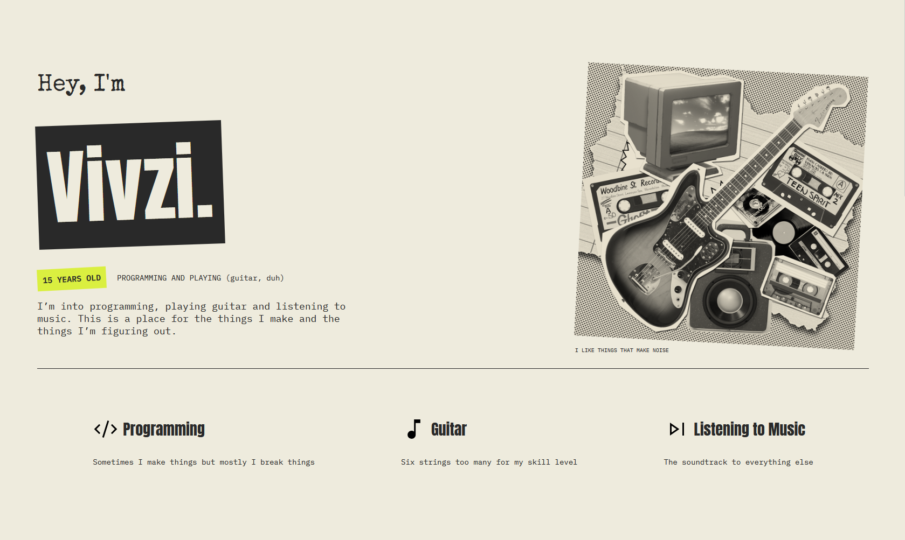
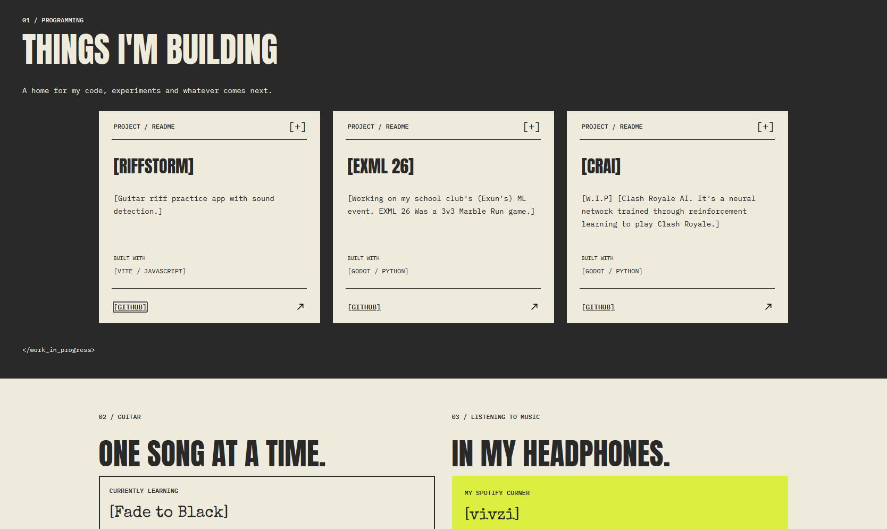
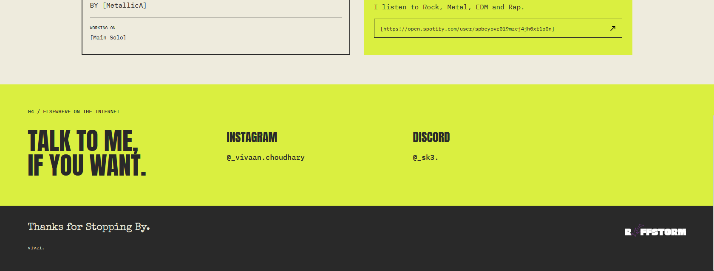

# About Me

This is a website that tells you all about me!

## Description

This is a website built with React + Vite. It is a 6-part website with each part containing small details about me like the projects I'm building, the guitar song I'm currently learning etc etc.
### Screenshots



## Getting Started

If you are (for some strange reason) interested in locally running this code, you can go ahead and do so:
### Installing

> [!NOTE]
> **Requires Node.js 20+**

Step 1. Clone the repo  

```bash  
git clone https://github.com/vivzi/about-me
```

Step 2. Download dependencies  

```bash  
npm install
```

### Running the website
Running the website is just as simple as installing.

Step 1. Start the dev server 

```bash
npm run dev
```

Step 2. Open `localhost:5173` in your browser

## Reflection
- I learned how to write better CSS
- I gained work experience with Figma and I feel more confident working with Figma
- I feel that I still need to learn better CSS though as I gave up at the end and used AI.

## License

This project is licensed under the MIT License.